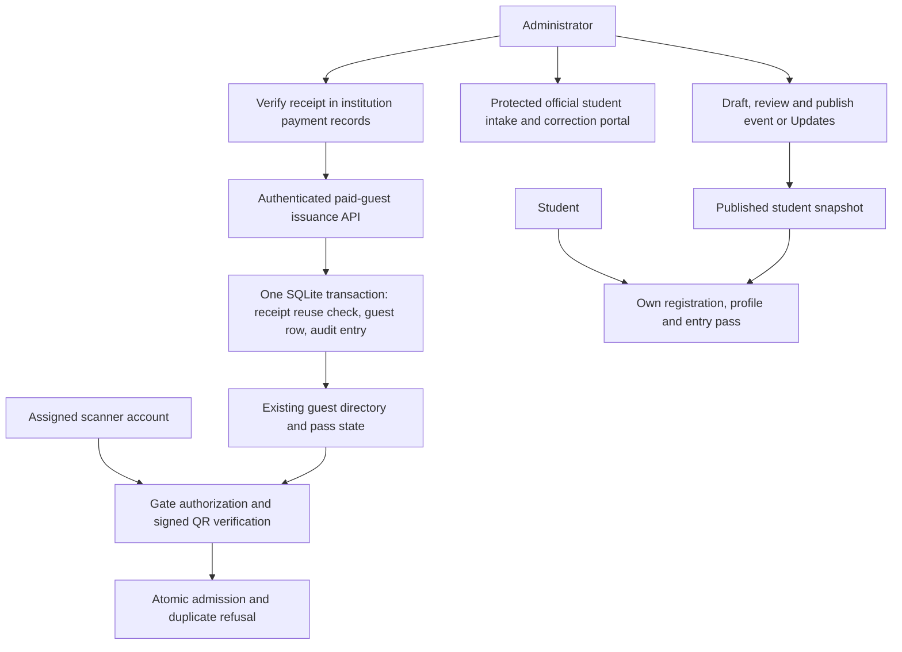

# Final phone audit and system design — 26 October 2026

Audit completed before implementation. All 56 supplied images were reviewed; repeated captures are identified below. Screenshots are evidence of visible state, not authorization to change records or proof that camera capture succeeded.

## Screenshot findings

| Images | Finding and disposition |
|---|---|
| 1, 2, 27, 55 | Tool switches work independently. Preserve current server settings. Admin settings are an excessively long form stack; provide grouped administrative destinations. Remove guest-registration claims from volunteer descriptions. |
| 3, 56 | Event editing works but dates/times require hand-entered technical formats. Improve field guidance and retain explicit draft/review/publish. Operational and published schedules are distinct; do not silently publish edits. |
| 4 | Student update composer correctly requires content, but is buried within configuration. Keep explicit review and publication; give it a direct admin destination. No email/SMS delivery is configured. |
| 5 | Connection succeeds. Long URL field scrolls horizontally; the separate full address is readable. Treat server configuration as advanced setup, not a routine dashboard task. |
| 6, 7, 11, 12 | Unchanged Save is correctly disabled; queue is empty and synced. Duplicate long event configuration competes with student publication controls. Group technical configuration separately. Zero target is unset, not a failed count. |
| 8, 9, 13, 14 | Operational message log and student Updates are still confusingly both called announcements. Retain separate delivery semantics; rename operational log and direct student publishing to administrator tools. Empty feed is valid. |
| 10, 15 | CRITICAL: Add guest is offered even before scanner sign-in. The server also accepts unauthenticated guest issuance. Hiding the button alone is insufficient. |
| 16 | Camera permission fallback and manual search are visible. Permission denial is a legitimate state. No actual camera capture is demonstrated here. |
| 17 | Search is idle until two characters; correct. Lookup requires scanner authorization and must not create a record or a pass. |
| 18, 19, 20, 21 | Volunteer Home permits all-gate selection independently of Scanner's authorized gate filtering. West Gate can appear selected on an account assigned Main Gate. Reuse scanner-session gate permissions and require sign-in first. Zero attendance/activity is valid. Compact the large gate/header/metrics stack. |
| 22, 23, 24 | CRITICAL: a volunteer can open an issuance form without payment evidence or admin authorization. Guest passes are paid. Move issuance to admin-only workflow with an attested payment reference and audit record. Volunteers only look up and scan existing passes. |
| 25, 26 | Device volunteer name is editable but server scan actor must remain authenticated identity. Keep operator preference distinct from account identity. Guest management wording is misleading for volunteers. |
| 28, 29 | Live attendance receives valid zeros, but cards touch and the large heading wraps awkwardly. Add consistent section gaps and compact header; do not fake live data to fill the display. |
| 30 | Admin PIN exit protection is correct. Retain cancel and explicit exit. |
| 31, 52, 53 | Connection setup succeeds but reads like a technical onboarding page. Keep advanced setup available, with a dashboard-first entry and an explicit connected state. Do not embed credentials. |
| 32 | Sign-in form is functional. It is an authentication form, not itself a dashboard; retain secure password input. |
| 33 | Student Home's primary pass action is below repeated account facts. This is the main dashboard hierarchy failure. Put entry readiness, schedule, concise metrics and quick actions above administrative record detail. |
| 34 | Invitation works after publication. Duplicate large status heading/card wastes space before the actual QR. Put gate entry first, followed by invitation/event/registration details. |
| 35, 36 | Long provisional-date pill squeezes Ceremony date into a narrow column. Stack date and status rather than placing the pill alongside a long row. Provisional date and demo notice are correct and must remain honest. |
| 36, 37 | Real QR issuance works. Do not copy its bearer payload into public evidence. Raw ISO timestamps and two refresh actions confuse the pass. Format Pakistan time and retain one clear QR action. |
| 38, 39, 40 | Registration status and official record are correct but repetitive and tall. Official record text is flush against card edge. Pad read-only record cards and move technical API commentary out of user copy. |
| 41, 42 | Profile completion works, but completion list and full official record dominate the editing task. Reduce spacing and use clear, padded record groups. |
| 43, 44 | Photo on file is claimed while the thumbnail area is blank. Image loading has no onError handler, so failure cannot update the existing error message. Add visible loading/error/retry state, preserve the stored photo and avoid publishing it. Phone saving works; a disabled saved button is expected. |
| 45, 46, 47 | Student dashboard content exists but is several screens below status text. Repeated progress bars and large buttons make it a landing-page stack. Move concise progress/attendance tiles and actionable destinations near the top. Keep profile/readiness concepts distinct. Move sign-out to Account, where it already exists. |
| 48 | Event view correctly distinguishes provisional ceremony from unannounced rehearsal. Header/eyebrow and card rows need compact, non-squeezing layouts. |
| 49, 50 | Marketing slogan/hero dominates the signed-out entry. Replace promotional landing content with an institutional service dashboard: clear account access, registration/pass/updates services and staff access. Never show private account data before login. |
| 51, 54 | Disabled tools and PIN gate are correct. Keep authentication separate from dashboard availability. Admin must manage paid passes even when scanning is paused. |

## Roles and server boundaries

| Capability | Student | Volunteer/scanner | Administrator |
|---|---|---|---|
| Own account/photo/contact | Own record only | No | Existing authorized management routes |
| Official student intake/import/correction | Request only | No | Existing protected Examination Department workflow |
| Operational roster intake | No | No | Existing protected administrator roster workflow |
| Issue guest pass | No | No | Only after attesting verified payment and entering payment reference |
| Revoke unused guest pass | No | No | Yes, audited; used passes remain terminal |
| Guest directory/manual lookup | No | Authenticated, minimal fields | Protected management directory |
| Gate admission | Own pass display | Assigned gates only | Provision scanner assignments; same server admission rules |
| Publish event/Updates | Read published snapshot | Read permitted data | Draft, review, publish explicitly |
| Tool availability/server settings | No | Device preferences only | Yes |

A paid pass is not proof of an online payment transaction. The administrator verifies the receipt in the institution's payment process, attests that verification, and records a reference. This app will not invent a payment gateway, fee, free entitlement or payment settlement. Record payment reference + actor + time atomically with issuance in the existing audit log. Reject reference reuse while serializing issuance. Keep existing one-pass-per-host/duplicate constraints until the institution defines a different purchased quantity policy. Existing passes are not relabelled as payment-verified or deleted.

Legacy POST /api/guests and /guests must be administrator gated too, so older APKs and direct requests cannot bypass the rule. Scanner tokens and student tokens never authorize issuance or revocation. Administrative issuance is independent of the volunteer availability switch. Public scoped guest-print access remains read-only for already issued passes.

Student management already has protected intake/import and review/audit workflows. Preserve them and link them from the admin hub; do not turn student self-activation into permission to insert an official record, and do not silently match the separate operational roster to official registrations.

## Dashboard structure

- Signed out: institutional brand, concise service grid, sign-in/activation, protected staff access; no promotional slogan or fake statistics.
- Student: compact identity and registration state; entry-pass action; ceremony/rehearsal overview; profile/readiness/attendance tiles; direct Updates, schedule and support actions. Full official record stays in Registration.
- Volunteer: authenticated assignment, scan/search actions, compact real attendance, gate activity and queue. Guest directory is lookup-only. Gate selection uses account assignments both here and in Scanner.
- Administrator: management hub for official student records, operational roster, paid guest issuance, student publications, availability and advanced configuration. No scanner role may mint or revoke a paid pass.

## Verification and deployment boundary

Test anonymous/student/scanner denial, administrator payment validation, duplicate receipt refusal, transactional audit, existing guest admission/duplicate/revocation rules and unchanged student intake authorization on disposable data. Inspect actual Expo layouts at 360x700 and 390x744. Verify image error feedback and readable Pakistan timestamps. TypeScript/lint plus relevant backend/CI checks must pass before publishing a new APK.

Deploy repairs to the synthetic host and publish a verified preview artifact after tests. Real campus deployment still requires the institution's actual hosting/database, payment-verification process, named administrator accounts and email configuration; no campus data or unprovided credentials will be fabricated. No startup schema migration, no real-photo/phone/QR publication, no demo settings silently promoted to official event data.

## Request and data flow

## Verified implementation

Administrator-only paid issuance and revocation are enforced on new and legacy HTTP routes. The payment reference is normalized and audited atomically with issuance; duplicate receipt reuse is refused under a serialized write lock. Administrative directory/pass access works independently of paused scanning. No schema migration is required. Issuance records administrator attestation, not settlement by a payment provider.

Volunteer guest creation/revocation controls are removed. Both scanner and Home gate choices now use scanner assignments. The signed-out service dashboard, student status/metric dashboard and administrator management hub are implemented. Gate QR appears before invitation detail; dates use Pakistan time; long provisional labels no longer squeeze the date row. Profile images load through authenticated fetch into memory, with failure/retry feedback.

Local validation: TypeScript and Expo lint pass; actual browser acceptance passes at 360x700 and 390x744, including dashboard navigation, protected photo display, paid-guest review, no volunteer issuance UI, both gate pickers and published Updates. The isolated security suite passes 138 checks, web E2E passes 60 scenarios, guest rate limiting passes 12 checks and mobile reliability passes 38 assertions. Dedicated administrator/payment and publication/real-QR tests pass. CI, hosting deployment and the APK release are tracked on PR 29.

Historical guest passes remain unchanged and are not newly asserted to have verified payment. Existing institutional passes must be reconciled with payment records before a campus cutover. The current one-pass-per-host constraint is retained; a different purchased-quantity policy requires an explicit institution rule. The existing shared preview PIN identifies the administrator role, not an individual cashier; campus operations should use the existing named staff management process.

Implementation references: [Expo 57 Linking](https://docs.expo.dev/versions/v57.0.0/sdk/linking/), [Expo Router navigation](https://docs.expo.dev/router/basics/navigation/), [React Native FileReader](https://reactnative.dev/docs/global-FileReader).
