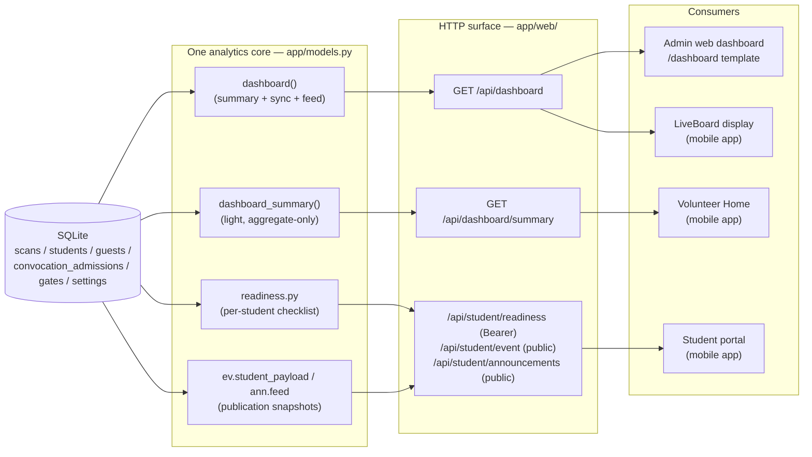

# Phase 37 — Shared Backend Analytics Design

**Status:** design record of the *existing* shared analytics backbone, with
change-control rules for keeping it shared. **No dashboard redesign is
performed or proposed here** (Phase 37 STEP 6 constraint).

Context: the Phase 36 audit found three surfaces (admin dashboard,
LiveBoard display, student portal) reading overlapping operational data.
This document makes the single-source architecture explicit so future
metrics cannot silently fork per surface.

---

## 1. Architecture

Both dashboard builders call the **same private helpers** (`_expected`,
`_inside_by_gender`, `_guests_inside`, `_admitted_by_occasion`,
`_throughput_map`, `_busiest_gate_label`, `_announcement_audience`,
`_arrival_pct`) — the full payload is a strict superset of the light one
plus `sync` and `feed`. There is exactly one place where an operational
number is computed.

## 2. Metric catalog (single-source semantics)

| Metric key | Source helper / tables | Semantics (Phase 35K/29 rules) |
|---|---|---|
| `student_roster_count`, `roster_male`, `roster_female` | `_expected` ← `students` | Roster rows (registrations), split by gender. |
| `guest_registrations` | `_expected` ← `guests` | Guest pass rows, not people inside. |
| `expected_attendance`, `attendance_set` | `_expected_attendance` ← `settings.expected_attendance` | Admin target; `0` ⇒ not set. **Never** substituted by roster count. |
| `arrival_pct` | `_arrival_pct` | `min(100, round(100×inside_total/expected))`; `0` when target unset — clients must branch on `attendance_set`. |
| `inside_total`, `male`, `female` | `_inside_by_gender` ← `scans` | Latest-scan-wins: a student counts inside only if their **latest** scan is entry. |
| `guests_inside` | `_guests_inside` ← `guests`/`scans` | Guest passes with any scan. |
| `ceremony_admitted`, `rehearsal_admitted` | `_admitted_by_occasion` ← `convocation_admissions` | Active convocation only; occasions counted separately (Phase 29). |
| `announcement_audience_count` | `_announcement_audience` | Default broadcast audience size. |
| `throughput[]` | `_throughput_map` ← `scans` | Entry scans per gate within `GATE_ACTIVITY_WINDOW_MINUTES` (server cutoff, `Asia/Karachi`). |
| `busiest_gate` | `_busiest_gate_label` ← `scans` | Gate label with most entries *today*; `"No scans yet"` when none. |
| `window_minutes` | `config.GATE_ACTIVITY_WINDOW_MINUTES` | Same value the `/dashboard` template renders — one source for labels and queries. |
| `generated_at` | `now_str()` | Server stamp; the authority for freshness decisions. |
| `sync[]` *(full only)* | `_sync_status` ← `scans`×`gates` | Per gate: `last`, `count`, `entries`, `exits`. |
| `feed[]` *(full only)* | query ← `scans` JOIN `gates` | Last 20 scans (`ORDER BY id DESC`), includes `person_name` — see §4. |

## 3. API contracts

### `GET /api/dashboard` → `models.dashboard()`
*Consumers:* admin web dashboard (`dashboard.html`, 5 s poll), LiveBoard
(`fetchDashboard`, 5 s poll). Unauthenticated read (§4).
All fields of §2 plus:

| Field | Type | Notes |
|---|---|---|
| `sync` | array of `{gate, last, count, entries, exits}` | `last: string\|null`, one entry per configured gate. |
| `feed` | array of scan rows + `gate_label` | Operational names only; `LIMIT 20`. |

### `GET /api/dashboard/summary` → `models.dashboard_summary()`
*Consumer:* volunteer `HomeScreen` (`fetchDashboardSummary`).
**Exactly §2 minus `sync` and `feed`** — `DashboardData` in
`mobile/src/api/client.ts` types both, so the summary is the same
contract with the operations-only arrays absent.

### Student portal feeds
| Endpoint | Auth | Contract |
|---|---|---|
| `/api/student/readiness` | Bearer token | `{counts:{required_done, outstanding,…}, generated_at, items:[{key,label,status(=done/required/…),…}]}` — per-account, server-computed; `mark()` writes read/dismiss state. |
| `/api/student/event` | public | Publication snapshot only (`ev.student_payload`) — drafts can never appear. |
| `/api/student/announcements` | public | Published `students`-audience rows only (`ann.feed`). |

**Contract rules:** additive-only field changes; every server-stamped
payload carries `generated_at`; the summary/full parity is maintained by
construction (shared helpers), never by re-implementing a query in a
screen or template.

## 4. Access controls

| Surface | Control | Notes |
|---|---|---|
| `/api/dashboard`, `/api/dashboard/summary` | **Unauthenticated read** | Deliberate: kiosk display + volunteer Home on the trusted LAN; no mutation possible through them; summary payload contains no names. Audit **BE-005** records the residual: the *full* payload's `feed` carries attendee names — backlog hardening is an optional read key/staff-session for `/api/dashboard` only, **deferred** because it would break the deployed display clients. |
| Student portal API | Bearer token (`Authorization`), 401 ends session | `me`, `readiness`, `support`, `pass`, `history`, mutations. |
| Staff web portal | Session cookie (HttpOnly, SameSite=Lax, `LGU_COOKIE_SECURE` for TLS) + CSRF tokens | Form posts. |
| Admin mutations (settings, rename, broadcast, verify, web unlock) | Shared PIN gate `_require_admin_pin()` — per-IP limiter (429 after `PIN_RATE_MAX_FAILS`, **BE-001**) + constant-time compare (`_pin_ok`/`hmac.compare_digest`, **SEC-002**) | Single bucket across JSON + form paths. |
| Scanner API | `X-Scanner-Token` (sha256 at rest, expiry, revocation) + server-side per-gate ACL | Client cannot choose its gates. |
| CORS | Explicit origin allowlist echo, `Vary: Origin`, `X-Admin-Pin`/`Authorization` in allow-headers | Native mobile sends no Origin — unaffected. |

## 5. Refresh behavior (client rules)

| Surface | Cadence | Staleness | Failure rule |
|---|---|---|---|
| LiveBoard | poll `5000 ms` | stale after 3 misses (`15 s`); offline flag after `30 s` | keep last values on screen; poll retries underneath; keep-awake while visible. |
| Admin web dashboard | `setInterval 5000 ms` | window label rendered from server `window_minutes` | last payload stays until replaced. |
| Volunteer Home | on show/focus + queue events | `generated_at` shown as server time | silent refresh keeps last data. |
| Student portal home | focus/resume/manual + ≤30 s foreground cadence | stale badge, keep-last | supplementary loads (event, readiness) fail honestly (`unavailable`), **only 401 terminates**; a network error never blanks the screen. |

Rules for new consumers: poll ≤10 s for live surfaces, never fabricate a
number locally, treat `generated_at` as the freshness authority, and keep
the last successful payload visible during failures.

## 6. DB queries (shape and cost)

All dashboard numbers come from **aggregate queries on one connection**
opened inside the helper and closed before return (`db.close()` / `finally`):

- `students`/`guests` counts — one grouped pass each (`_expected`).
- latest-scan state per person — window/`GROUP BY` over `scans` filtered to
  the relevant `qr_id` set (`_inside_by_gender`, `_guests_inside`).
- admissions — `GROUP BY occasion` on the active convocation
  (`convocation_admissions`, partial UNIQUE per occasion backstop).
- throughput — `scans WHERE mode='entry' AND scanned_at >= cutoff GROUP BY gate_id`.
- busiest gate — same with `date(scanned_at) = today`, `ORDER BY c DESC LIMIT 1`.
- sync — `scans GROUP BY gate_id` with `MAX/COUNT/SUM`.
- feed — `JOIN gates … ORDER BY id DESC LIMIT 20`.

Cost posture: table-scans over `scans` are O(rows); at convocation scale
(thousands of scans/day) they are well inside a 5 s poll budget on SQLite.
If the roster or scan volume grows by an order of magnitude, the first
lever is an index on `scans(scanned_at)` / `scans(gate_id, mode)` — a
backlog observation only, not part of this change.

## 7. Change control — adding a metric without forking

1. Compute it in **one helper** in `models.py` next to the existing ones.
2. Add it to `dashboard_summary()` first (the light contract), then to
   `dashboard()` — both must return identical values for shared keys.
3. Extend `DashboardData` in `mobile/src/api/client.ts` once (additive).
4. Add a contract/source check to the regression battery (pattern:
   `mobile/scripts/*-source-test.mjs`).
5. Never query operational tables from a screen, template or ad-hoc
   endpoint — that is how the three surfaces would diverge.

## 8. Explicit non-goals / deferred backlog

- No layout, screen or payload redesign (Phase 37 constraint).
- BE-005 dashboard-read hardening (read key for `feed`) is **deferred** —
  it changes a deployed client contract and needs its own acceptance cycle.

## 9. Phase 38 addendum — shipped from this design

Phase 38 implemented the deferred items above under the same §7 change
control, all additive, no payload redesign:

1. **Student attendance card — no longer deferred.** The scheduled
   `dashboard_summary` reuse was replaced by a dedicated counts-only
   endpoint, `GET /api/student/attendance` (student session required),
   returning `registered / verified / remaining / percentage / expected /
   attendance_set / generated_at`. It shares the exact population
   semantics of the dashboard aggregates but crosses no privacy boundary:
   no names, gates, feed, throughput, gender split, rejection detail, or
   broadcast audience. Rendered as a live card on the student home portal.
2. **Shared metric block shipped:** `remaining_attendance`,
   `rejected_count`, `duplicate_count`, `trends` (hourly entry/exit/
   cumulative), `poll_interval_ms` (clamped 2000–30000 ms), and
   `admissions_by_occasion` are present in both `dashboard_summary()` and
   `dashboard()` — identical values for shared keys, verified by the
   payload-parity section of `test_phase38_analytics.py`.
3. **Shared cadence constant exported to clients** (previously deferred):
   every dashboard response now carries `poll_interval_ms`; the liveboard,
   admin dashboard (`dashboard.html`) and server clamp it to the same
   2 s–30 s band on both ends, and consumers schedule one-shot requests
   (no overlapping refreshes) with staleness/offline bands scaled from the
   cadence (floors preserve the Phase 35I/L thresholds).
4. **Rejection logging design landed as planned:** one choke point in
   `process_scan` after the verdict (busy never logged), duplicate ⊆
   rejected via a single `is_duplicate` flag, sync/scan request-level
   refusals logged with `source="queued"`, day-scoped counts, honest zeros
   before migration v14. Trends count scan EVENTS; occupancy keeps the
   V-RACE-01 dedupe — the two deliberately differ and neither invents data.
5. Occasion filtering (`?occasion=ceremony|rehearsal`) is applied at the
   ROUTES layer so light (`api_dashboard_summary`) and full payloads
   cannot diverge; untouched without the parameter, 400 on invalid values.

Still deferred (unchanged from earlier phases): BE-005 feed-read
hardening; DB-001 remains operator-approval only (production stays at
user_version 6 — v14 is developed and proven on disposable databases).
