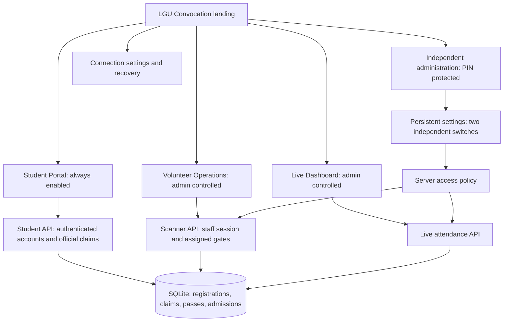

# LGU Convocation system design

## Product entry and navigation

The landing screen presents Student Portal first. It carries registration,
profile, entry pass, updates, and student support. Volunteer Operations and Live
Dashboard are secondary event tools with separate availability controls.
Administration and connection recovery remain reachable outside those tools.
The app name is LGU Convocation in every build variant.

Choosing a dashboard changes a device preference, not its permissions. A role
change requires confirmation; each server API still authenticates its caller.
Disabled and disconnected are different states, with different recovery actions.
Entry screens scroll on small devices and large system text settings.

## Server boundaries

- Student: an account can claim only its matching active official registration.
  Registration number, university email, roll number, name, email verification,
  claim uniqueness, throttling and session checks remain authoritative on the
  server. A client cannot grant eligibility or select another student's claim.
- Volunteer: scanner sessions and assigned gates authorize operational access.
  Disabling this surface rejects new scanner/guest/search/sync requests. Existing
  queued scans remain local until reopening; a refused batch processes no items.
- Live: the full attendance endpoint and web live page share the Live Dashboard
  switch. Volunteer summary has a separate endpoint, so Live can be off while
  gate operations continue.
- Admin: PIN-protected settings have an independent mobile route. Disabling both
  operational surfaces cannot prevent an administrator reopening them. Saving
  event details sends only those fields, so an old form cannot overwrite switches.

Availability settings live in the existing settings table. Existing databases
default to enabled; no schema migration or rebuild is needed for a switch change.
Student availability is a constant true value, not an administrator setting.
Requests already in progress may finish before a disable takes effect.

## Runtime state and load

`useDashboardAvailability` is the common lifecycle policy for landing and access
gates. It checks the lightweight, uncached `/api/dashboard-access` endpoint every
15 seconds while focused and active, refreshes on foreground return, prevents
overlapping requests, and ignores responses after unmount. It does not compute
attendance analytics. The client validates the response before trusting it.

| State | App behavior |
|---|---|
| Checking | Explicit progress; no fabricated enabled/disabled result |
| Online and enabled | Open the selected surface after checking current access |
| Online and disabled | Show administrator-disabled status; preserve student/admin access |
| Disconnected | Offer Retry and connection settings |
| Operational screen disabled during use | Unmount camera and screen polling after the next successful check |
| Network lost after confirmed access | Retain last known access for offline work; server enforcement applies when requests resume |

Shared configuration, health, student and admin APIs stay independent of event
tool availability. Native requests and allowed-origin browser requests support
scanner tokens; arbitrary web origins receive no CORS grant.

## Local testing and deployed operation

`Start-LGU.ps1` or `npm start` in `mobile` launches this checkout's local backend,
waits for health, then launches Expo Go. The backend uses a persistent synthetic
database and generated local accounts outside the repository. Expo discovers the
laptop on the same Wi-Fi. A saved custom server takes priority.

Always-enabled Student Portal is a product policy, not an uptime guarantee. Real
continuous operation requires a reachable hosted backend, current database and
backups, HTTPS, server secrets and SMTP. The local test backend deliberately has
email delivery disabled; tests use an isolated fake provider. No test result here
claims real email delivery, continuous hosting, or physical camera validation.

## Validation

`test_dashboard_access.py` exercises protected settings, strict values, independent
switches, persistence, student login and eligible signup with both tools off,
unmatched registration rejection, reopening and browser preflight. The existing
student account and scanner/API suites cover account isolation, claims, pass
reuse, assigned gates, offline reconciliation and production database isolation.
`dashboard-availability-test.mjs` executes the actual TypeScript client and hook
with controlled network, focus, timers and app state to test validation, request
overlap, background pause, foreground refresh, offline retention and cleanup.

TypeScript, lint and full Android bundling cover mobile integration. Visual web
and physical-phone acceptance are separate checks; a bundle is not visual QA.
